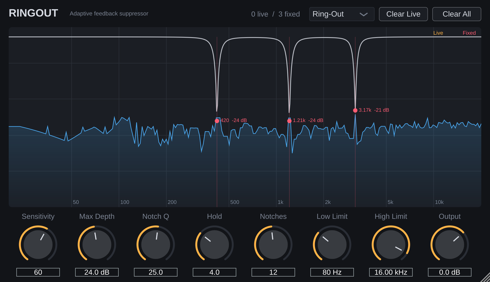

# RingOut: adaptive feedback suppressor

A VST3 / AU / Standalone plug-in in the spirit of De-Feedback. It listens for acoustic feedback (howl, ringing) and drops narrow notch filters onto it automatically. It adds **zero latency**, so you can put it on live vocal or podium mic channels.



## How it works

1. **Notch, then listen.** Audio passes through a bank of up to 24 narrow peaking-cut filters (minimum-phase IIR, no latency). The *output* is analysed, so a notch stops deepening once it has broken the loop.
2. **Detect.** A 4096-point STFT (75% overlap, about 12 Hz bins at 48 kHz) looks for peaks that look like feedback rather than music:
   - **Narrow:** a pure sinusoid, with nothing 4–5 bins out.
   - **Prominent:** far above the local spectral floor.
   - **Pitch-stable:** the frequency holds to a fraction of a bin. Vibrato and slides fail this test.
   - **Sustained:** the level is steady or rising, with no dip. Plucked notes decay and repeated notes dip between hits, so they fail this test.
   - Peaks that belong to a harmonic series (voices, instruments) must also persist 3× longer and meet a stricter pitch limit.
3. **Act.** A new detection gets a 6 dB notch at the measured frequency. If it keeps ringing, the notch deepens by 3 dB per detection, up to *Max Depth*. Gains glide over about 15 ms, so changes don't click.
4. **Release.** In Live mode, a notch that hasn't been retriggered for *Hold* seconds releases at 6 dB/s and frees its slot.

## Controls

| Control | What it does |
|---|---|
| **Mode** | **Live**: notches float in and out as needed. **Ring-Out**: every notch placed is *fixed* and kept, so you can ring out the room at soundcheck by pushing the gain until it howls. **Freeze**: hold everything as it is and add nothing. |
| **Sensitivity** | Higher catches feedback sooner and quieter (persistence about 110 ms at 100%, 500 ms at 0%), at the cost of more false notches on music. |
| **Max Depth** | Deepest cut any one notch may reach (3–48 dB). |
| **Notch Q** | Width of each notch. Higher means narrower and more transparent. |
| **Hold** | How long a Live notch stays after the feedback stops before it releases. |
| **Notches** | How many notches may be active at once (1–24). When full, the quietest Live notch is recycled. Fixed notches are never stolen. |
| **Low / High Limit** | Frequency range that is searched for feedback. |
| **Output** | Make-up / trim gain. |
| **Clear Live / Clear All** | Remove the floating notches only, or everything including learnt ones. |

Learnt (fixed) notches are saved with your session or preset.

**Typical use:** set Ring-Out at soundcheck and bring the mic up until it rings. Let RingOut catch the first few frequencies, then switch to Live for the show so it can catch anything new.

## Getting the plug-in

Every push that touches `ringout-vst/` runs the **RingOut plug-in** GitHub Actions workflow. It builds Windows, macOS (universal) and Linux, runs the DSP tests, and uploads `RingOut-<OS>` artifacts containing `RingOut.vst3` (plus `RingOut.component` on macOS) and the standalone app.

Install by copying the files to:

- **Windows:** `C:\Program Files\Common Files\VST3\`
- **macOS:** `~/Library/Audio/Plug-Ins/VST3/` and `~/Library/Audio/Plug-Ins/Components/`. The builds are unsigned, so run `xattr -dr com.apple.quarantine <file>` once on each.
- **Linux:** `~/.vst3/`

## Building locally

Requires CMake 3.22+ and a C++17 compiler. JUCE 8 is downloaded automatically.

```bash
cd ringout-vst
cmake -B build -DCMAKE_BUILD_TYPE=Release
cmake --build build --config Release --parallel
./build/RingOutTests_artefacts/Release/RingOutTests   # offline DSP tests
```

On Linux, first install: `libasound2-dev libxrandr-dev libxinerama-dev libxcursor-dev libxcomposite-dev libfontconfig1-dev libfreetype-dev libgl1-mesa-dev`.

## Tests

`Tests/RingOutTests.cpp` runs the engine offline against:

- a steady tone in noise (must be found to within 15 Hz)
- plucked harmonic notes, sung notes with vibrato and a repeated bass note (must **not** be notched)
- a simulated **closed mic→speaker loop** with a room resonance that howls at +6 dB loop gain. Without RingOut the output saturates at about −1 dBFS. With it, the output settles to about −37 dBFS (the source is −40 dBFS) using 4 notches.

The VST3 also passes [pluginval](https://github.com/Tracktion/pluginval) at strictness level 8.

## Limitations compared with De-Feedback

De-Feedback uses a trained neural network to separate feedback from the source. RingOut uses classic signal analysis plus notch filtering. That's transparent and predictable, but a very pure, perfectly steady sustained tone (sine synth, organ, test tone) can look like feedback to it. Lower the Sensitivity, narrow the Low/High limits, or switch to Freeze for those passages.

## Code layout

```
Source/dsp/FeedbackDetector.*   STFT peak analysis and tracking (no allocations on the audio thread)
Source/dsp/NotchBank.*          the adaptive notch filters
Source/dsp/RingOutEngine.h      detector + bank, independent of the plug-in wrapper
Source/PluginProcessor.*        parameters, state (including learnt notches), GUI data
Source/PluginEditor.*           spectrum analyser, notch curve and controls
```
